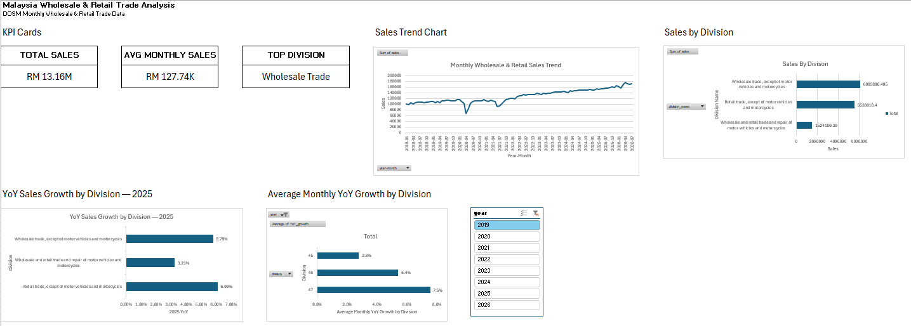

# Malaysia Wholesale & Retail Trade Analysis | Excel

## 📌 Project Overview

This project analyses Malaysia's **Wholesale & Retail Trade** performance using monthly data from the **Department of Statistics Malaysia (DOSM)**.

The analysis was conducted in **Microsoft Excel** to examine sales trends, division-level performance, and year-over-year (YoY) growth. An interactive dashboard was developed to present key findings in a clear and business-friendly format.

The project demonstrates practical Excel skills in **data preparation, PivotTables, lookup functions, KPI development, trend analysis, and dashboard design**.

---

## 🎯 Objectives

The main objectives of this project are to:

- Analyse Malaysia's wholesale and retail trade sales performance over time
- Compare sales performance across different trade divisions
- Identify periods of growth and decline
- Calculate and compare annual YoY growth
- Identify the largest contributing trade division
- Develop an Excel dashboard for communicating business insights

---

## 📊 Dataset

**Source:** Department of Statistics Malaysia (DOSM)

The dataset contains monthly wholesale and retail trade statistics, including:

- Date
- Division
- Sales
- Volume
- Seasonally adjusted volume
- YoY growth

### Trade Divisions

| Division | Description                                                        |
| -------- | ------------------------------------------------------------------ |
| 45       | Wholesale & retail trade; repair of motor vehicles and motorcycles |
| 46       | Wholesale trade, except of motor vehicles and motorcycles          |
| 47       | Retail trade, except of motor vehicles and motorcycles             |

> **Note:** 2026 data is incomplete and currently covers January–July only. Therefore, annual comparisons in this analysis use complete years up to 2025.

---

## 🛠️ Tools & Skills

**Tool:**

- Microsoft Excel

**Excel Skills:**

- Data cleaning and preparation
- Excel Tables
- XLOOKUP
- PivotTables
- PivotCharts
- KPI calculations
- Year-over-Year (YoY) analysis
- Percentage calculations
- Data visualization
- Dashboard design
- Business insight generation

---

## 🔄 Analysis Process

### 1. Data Preparation

The raw DOSM dataset was separated into analysis-ready datasets:

- **Raw Data** — original dataset
- **Sales Data** — records containing actual sales values
- **YoY Data** — records containing YoY growth rates
- **Lookup** — division code and division name mapping

Additional fields such as **Year** and **Year-Month** were created to support time-series analysis.

### 2. Sales Performance Analysis

PivotTables were used to analyse:

- Total sales by year
- Sales by division
- Sales by division and year
- Monthly sales trends

### 3. YoY Growth Analysis

Annual sales totals were compared to calculate YoY growth.

The analysis focuses on **2025 vs 2024** for the latest complete-year comparison.

### 4. Dashboard Development

An Excel dashboard was created to provide a high-level overview of Malaysia's wholesale and retail trade performance.

The dashboard includes:

**KPI Cards:**
- Total Sales
- Average Monthly Sales
- Top Division

**Charts & Visualisations:**
- Sales Trend
- Sales by Division
- 2025 YoY Growth by Division

**Interactive Features:**
- Year filter/slicer

---

## 📈 Key Insights

### 1. Wholesale trade was the largest contributor

Wholesale trade (Division 46) accounted for approximately **46.3%** of total recorded sales across the available period, making it the largest contributor among the three divisions.

### 2. Overall sales increased substantially over the long term

Annual total sales increased from approximately **1.25 million in 2018 to 1.87 million in 2025**, representing an increase of approximately **48.9%**.

### 3. Sales declined in 2020

Total annual sales decreased by approximately **5.8% from 2019 to 2020**, with the monthly trend showing a particularly sharp decline during 2020.

### 4. Strong recovery occurred from 2022 onwards

Total sales increased by approximately **19.6% in 2022 compared with 2021**, followed by continued annual growth through 2025.

### 5. Retail trade recorded the highest 2025 growth

In 2025, annual YoY growth was approximately:

| Division                     | 2025 YoY Growth |
| ---------------------------- | --------------: |
| Motor Vehicles & Motorcycles |       **3.23%** |
| Wholesale Trade              |       **5.79%** |
| Retail Trade                 |       **6.09%** |

This highlights that the division contributing the most sales is not necessarily the division experiencing the fastest growth.

---

## 📊 Dashboard Preview



---

## 📁 Project Structure

```text
Malaysia-Wholesale-Retail-Trade-Analysis/
│
├── README.md
│
├── data/
│   └── wholesale_retail_trade.csv
│
├── Excel/
│   └── Malaysia Wholesale & Retail Trade Analysis.xlsx
│
├── images/
    └── dashboard.png
```

---

## 💡 Business Recommendations

Based on the analysis:

- **Monitor wholesale trade closely** as it represents the largest share of overall sales.
- **Investigate the drivers behind retail trade's stronger 2025 growth** to identify potential opportunities for continued expansion.
- **Track monthly sales trends** to identify periods of unusual growth or decline.
- **Compare division-level growth with overall market performance** rather than relying solely on total sales.
- **Continue monitoring post-2025 data** as additional 2026 observations become available.

---

## 🚀 Future Improvements

Potential extensions of this project include:

- Adding more recent DOSM data as it becomes available
- Incorporating additional economic indicators
- Building a more interactive dashboard with additional filters
- Conducting regional-level analysis if suitable data is available
- Comparing sales and volume trends
- Adding automated data refresh functionality

---

## 📚 Data Source

Department of Statistics Malaysia (DOSM) — Wholesale & Retail Trade Statistics.

The dataset used in this project is based on publicly available Malaysian official statistics.

---

## 👩‍💻 Project Purpose

This project was developed as part of a **data analytics portfolio** to demonstrate practical Excel-based data analysis, business intelligence, and data visualization skills.

**Skills demonstrated:**
`Excel` `PivotTables` `XLOOKUP` `Data Analysis` `YoY Analysis` `Dashboard` `Data Visualization` `Business Insights`
